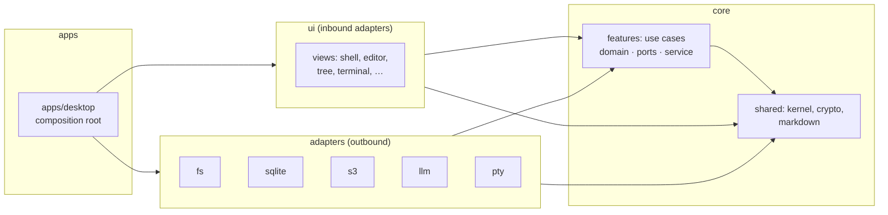

# Margin architecture

Margin is a local-first Markdown editor. Notes are plain `.md` files in a folder
the user picks; derived data lives in the vault's hidden `.margin/` folder; sync
mirrors the vault, encrypted on the device, to any S3 bucket. This document
describes how the native Rust app is built. Decisions and their evidence are in
[`decisions/`](decisions/); visual and interaction rules are in
[DESIGN.md](../DESIGN.md); the rules that keep the code this way are in
[AGENTS.md](../AGENTS.md).

## Goals

In priority order:

1. **Fast.** Typing, scrolling and opening a note never wait on I/O. 120 Hz
   rendering on the GPU; heavy work on background threads.
2. **Light.** Lowest memory and idle CPU we can get without giving up 1., and
   the smallest installer.
3. **Compatible.** A vault, profile registry and S3 bucket written by the Tauri
   releases (≤ 0.1.30) open unchanged.
4. **Maintainable.** Small crates with one job each, dependencies that point
   inward, every rule machine-checked.

The UI is GPUI through GPUI Kit ([0001](decisions/0001-ui-framework.md)).

## Hexagonal layers

Dependencies point inward. The core knows nothing about GPUI, SQLite, S3,
`std::fs` or HTTP; adapters know nothing about each other; the desktop app wires
them together.

### Layers

| Layer        | Path                    | May depend on                                       | Owns                                                         |
| ------------ | ----------------------- | --------------------------------------------------- | ------------------------------------------------------------ |
| **shared**   | `crates/shared/<name>`  | shared, allowlisted pure crates                     | Vocabulary types, cross-feature ports, bit-exact formats      |
| **features** | `crates/features/<name>`| shared, features, allowlisted pure crates           | Entities, rules, ports, use cases                            |
| **adapters** | `crates/adapters/<name>`| shared, features, any external crate                | One port implementation each: disk, SQLite, S3, HTTP, PTY    |
| **ui**       | `crates/ui/<name>`      | shared, features, ui, `gpui-kit`                    | Views and elements; call use cases, never adapters           |
| **apps**     | `crates/apps/<name>`    | everything                                          | `main`, the composition root, window and process lifecycle   |
| **testing**  | `crates/testing/<name>` | shared, features, allowlisted pure crates           | Fakes and port conformance suites; a dev-dependency only     |
| **tooling**  | `xtask`                 | external crates only                                | Repository checks                                            |

`cargo xtask check-deps` enforces the table from every crate manifest and requires
every dependency version to come from `[workspace.dependencies]`; core crates
also may not name `std::fs`, `std::net`, `std::process`, `std::env` or
`std::thread` (`cargo xtask check-invariants`).

### Feature crates

A feature crate has fixed files and nothing else:

| File         | Holds                                                                    |
| ------------ | ------------------------------------------------------------------------ |
| `lib.rs`     | Crate docs, `mod` declarations, `pub use` re-exports. No items.          |
| `domain.rs`  | Entities, value types and pure rules. Imports only shared crates.        |
| `ports.rs`   | Traits the use cases need from the outside world.                        |
| `service.rs` | Use cases: a service struct holding `Arc<dyn Port>`s.                     |
| `error.rs`   | The crate's `Error` enum (`thiserror`).                                   |

A file that outgrows 400 lines means the crate does two things: split the crate.
Integration tests live in `tests/` and drive the service through fakes from
`margin-test-support`.

| Crate               | Use cases                                                                         |
| ------------------- | --------------------------------------------------------------------------------- |
| `margin-vaults`     | Mnemonic generation, key derivation, vault profiles (create, unlock, rename, delete, reveal) |
| `margin-files`      | Listing, visible tree, create/rename/copy/import, search and replace, ZIP export   |
| `margin-attachments`| Content-addressed attachment storage, unused-attachment sweep                      |
| `margin-trash`      | Move to trash, list, restore, delete, empty, 30-day purge                          |
| `margin-search`     | Full-text index, tags, backlinks, fuzzy file filter                               |
| `margin-history`    | Snapshots, retention, diff input                                                  |
| `margin-settings`   | Encrypted settings and workspace state, settings export/import string            |
| `margin-sync`       | Manifest, three-way diff, tombstones, encrypted transfer with retried store calls |
| `margin-ask`        | The read-only agent loop answering questions from the vault                       |
| `margin-terminals`  | Terminal sessions over a PTY port                                                |

### Shared crates

| Crate             | Owns                                                                      |
| ----------------- | ------------------------------------------------------------------------- |
| `margin-kernel`   | `RelativePath`, `UnixMillis`, `Secret`, `StoreError`, `BoxFuture`, `Page`/`PageRequest`/`Cursor`, ports used by several features (`FileSystem`, `HostFiles`, `Clock`, `Timer`, `Watcher`) |
| `margin-crypto`   | BIP-39 → seed → vault id and key, AES-256-GCM-SIV blob format, HMAC object keys |
| `margin-markdown` | The Markdown + Obsidian-syntax parser the editor and exports render from  |
| `margin-retry`    | `RetryPolicy` (exponential backoff, jitter), `Retryable`, `retry` with an injected sleep |
| `margin-dates`    | Civil dates/times from `UnixMillis` with a UTC offset, ISO 8601 parse/format, today/yesterday grouping |
| `margin-test-support` (`crates/testing/support`) | In-memory fakes, the per-port conformance suites and compatibility fixtures |

"Core" means the shared and features layers.

### UI crates

Inbound adapters, one surface each, all built on `gpui-kit`:

| Crate                    | Owns                                                                 |
| ------------------------ | -------------------------------------------------------------------- |
| `margin-theme`           | The light/dark token table, the original type scale, its projection onto the GPUI Kit theme |
| `margin-i18n`            | Message lookup over `messages/{en,it}.json`, locale switching         |
| `margin-workbench`       | Shared UI vocabulary: vault services handle, actions, open requests, `TabContent`, the `DraggedFiles` drag payload |
| `margin-panes`           | Panes and tab strips: splits, tab drag between panes, drop zones, closed-tab history |
| `margin-breadcrumbs`     | The breadcrumb row above each tab and its folder menus                |
| `margin-editor`          | The note editor view: input, selection, mouse, drop targets, saving   |
| `margin-text-buffer`     | Text plus selections and grouped undo over a parsed `Document`        |
| `margin-editor-commands` | Editing commands: lists, marks, autopair, slash items, paste rules, block moves |
| `margin-editor-actions`  | Editor actions and their key bindings                                 |
| `margin-editor-overlays` | Completion and slash menus, selection bubble, context menu, lightbox  |
| `margin-editor-assets`   | Code highlighting, math and diagram images, embeds, link resolution   |
| `margin-live-preview`    | Row planning for live preview and raw mode: hidden markup, inline styles |
| `margin-table-editing`   | Table operations, cell navigation and the table menus                 |
| `margin-find-bar`        | Find and replace in a note                                            |
| `margin-properties`      | The frontmatter properties panel                                      |
| `margin-diagrams`        | TeX math (RaTeX) and Mermaid rendered to theme-coloured SVG, pure functions |
| `margin-file-tree`       | Sidebar tree: virtualized rows, selection, rename, drag and drop      |
| `margin-spotlight`       | The palette: files, full text, tags, ask, replace                     |
| `margin-terminal`        | Terminal dock: `alacritty_terminal` grid element, tabs                |
| `margin-viewers`         | Image, PDF and unknown-file views                                     |
| `margin-canvas`          | The drawing canvas                                                    |
| `margin-panels`          | Backlinks, history, trash, sync status                                |
| `margin-preferences`     | The settings dialog: vault, sync, AI, appearance, language, export, updates |
| `margin-onboarding`      | Intro, vault picker and vault wizard                                  |

`margin-desktop` (`crates/apps/desktop`) builds the services from adapters in
`container.rs`, owns the window, the shell layout (sidebar, panes, terminal,
right panel, status bar), global actions, workspace persistence and the updater.

### Ports and adapters

| Port (home)                         | Adapter crate    | Backed by                         |
| ----------------------------------- | ---------------- | --------------------------------- |
| `FileSystem`, `HostFiles`, `Clock`, `Watcher` (kernel) | `margin-fs` | `std::fs`, atomic temp-file writes, `notify` |
| `Timer` (kernel)                    | `margin-desktop` | Tokio `sleep`                     |
| `SearchIndex` (search)              | `margin-sqlite`  | `rusqlite` + FTS5                 |
| `BlobStore` (sync)                  | `margin-s3`      | `reqwest` over rustls, SigV4 signed in-crate |
| `LanguageModel` (ask)               | `margin-llm`     | `reqwest` SSE, OpenAI and Anthropic formats |
| `PtyHost` (terminals)               | `margin-pty`     | `portable-pty`                    |

Rules:

- **Core owns formats, adapters move bytes.** Encryption, JSON shapes, path
  layout under `.margin/` and S3 object keys are decided in core, so a fake
  adapter exercises the real format and a new adapter cannot drift.
- **Ports are object-safe** and services hold `Arc<dyn Port>`: one copy of each
  use case in the binary (installer size) and UI crates that never see an
  adapter type. Async port methods return `BoxFuture`.
- **Every adapter passes its port's conformance suite** from `margin-test-support`,
  the same suite the in-memory fake passes.

### Runtime model

- GPUI owns the main thread. Views spawn work with `cx.spawn` /
  `cx.background_spawn` and apply results on the main thread, tagged with a
  revision so stale results are dropped.
- Network adapters need Tokio. The composition root starts one multi-thread
  Tokio runtime; adapters receive its `Handle` and spawn on it, so core futures
  stay runtime-agnostic.
- Blocking work (hashing, indexing, walking a vault) runs on the background
  executor, never on the main thread.

### Errors

Each crate defines one `Error` enum; adapters report `StoreError` (kernel),
which features wrap. Panics mean bugs. The UI turns errors into a notification
with a localized message; nothing is reported only to a log.

## Compatibility contract

These formats are frozen; changing one is a migration.

- **App data** (`dirs::data_dir()/com.lowsbarrel.margin`): `device.key` (32
  random bytes) and `profiles.enc` (AES-256-GCM-SIV under the device key of
  `{profiles:[{name,mnemonic,vault_path}],last_used}`); legacy `session.enc`
  migrates into profiles; an unreadable registry moves to `profiles.enc.bad`.
- **Vault** `<vault>/.margin/`: `vault.id`, `settings.enc`, `workspace.enc`,
  `sync-base.enc` (vault key), `index.sqlite` (FTS5, schema 4, rebuildable),
  `history/<rel>/<unix_ms>.<ext>` (raw bytes), `trash/<unix_ms>-<n>/{path,files/,history/}`
  (purged after 30 days). Atomic writes go through `.margin-write-<n>.tmp`
  siblings. Hidden paths are skipped by every walker, watcher, sync and export.
- **Crypto**: BIP-39 12-word mnemonic → 64-byte seed; vault id = hex
  SHA-256(seed[0..32]); vault key = seed[32..64]; blob = 12-byte nonce ‖
  AES-256-GCM-SIV ciphertext.
- **S3**: prefix `<vault_id>/`; files at `files/<hex(HMAC-SHA256(rel)[0..16])>.enc`;
  manifest v3 `{version, files:[{path,hash,modified,deleted_at?}]}`.
- **Canvas** `*.canvas`: JSON `{strokes,shapes,textLabels,camX,camY,zoom}`.
- **Updater**: `latest.json` from the GitHub release, minisign signatures,
  public key as in the Tauri configuration.

## Testing

| Level        | Where                                   | Drives                                                        |
| ------------ | --------------------------------------- | ------------------------------------------------------------- |
| Unit         | `#[cfg(test)] mod tests` in the file    | Pure rules: parsers, diff, retention, path rules, formatting   |
| Use case     | `crates/features/<name>/tests/`         | A service over `margin-test-support` fakes                          |
| Conformance  | `crates/adapters/<name>/tests/`         | The real adapter through its port's shared suite (temp dirs, SQLite in memory, a local S3 stub) |
| UI           | `crates/ui/<name>/tests/`               | Real views in headless GPUI windows (`#[gpui_kit::test]`): input, focus, state |
| End to end   | `crates/apps/desktop/tests/`            | The composed app over a temporary vault: unlock, edit, save, search, history, trash, sync against the S3 stub |
| Compatibility| `crates/testing/support/fixtures/`       | Vault and bucket fixtures written by Tauri 0.1.30, read back byte for byte |

Tests are deterministic: no network, no wall clock (`Clock` port), no shared
temp paths. Fakes for external services pass the same conformance suite as the
real adapters.

## Platforms

Every release ships for six targets, each built and tested in CI on a native
runner:

| OS      | x64                                | arm64                              | Installer                    |
| ------- | ---------------------------------- | ---------------------------------- | ---------------------------- |
| Windows | `x86_64-pc-windows-msvc`           | `aarch64-pc-windows-msvc`          | NSIS `.exe`, `.msi`          |
| macOS   | `x86_64-apple-darwin`              | `aarch64-apple-darwin`             | `.dmg`, `.app.tar.gz` (updater) |
| Linux   | `x86_64-unknown-linux-gnu`         | `aarch64-unknown-linux-gnu`        | `.AppImage`, `.deb`          |

GPUI renders through DirectX 11 on Windows, Metal on macOS and Vulkan on Linux
(X11 and Wayland). Platform-specific code is `#[cfg(target_os = …)]`-gated in
adapters and the desktop app only, never in core.

## Budgets

Checked before each release on Windows, macOS and Linux:

| Metric                           | Budget     |
| -------------------------------- | ---------- |
| Windows installer                | ≤ 12 MB    |
| Warm start to first frame        | ≤ 300 ms   |
| Working set, vault of 1,000 notes, one note open | ≤ 150 MB |
| Idle CPU, window unfocused       | 0          |
| Keystroke to frame, 10,000-line note | ≤ 8 ms |
